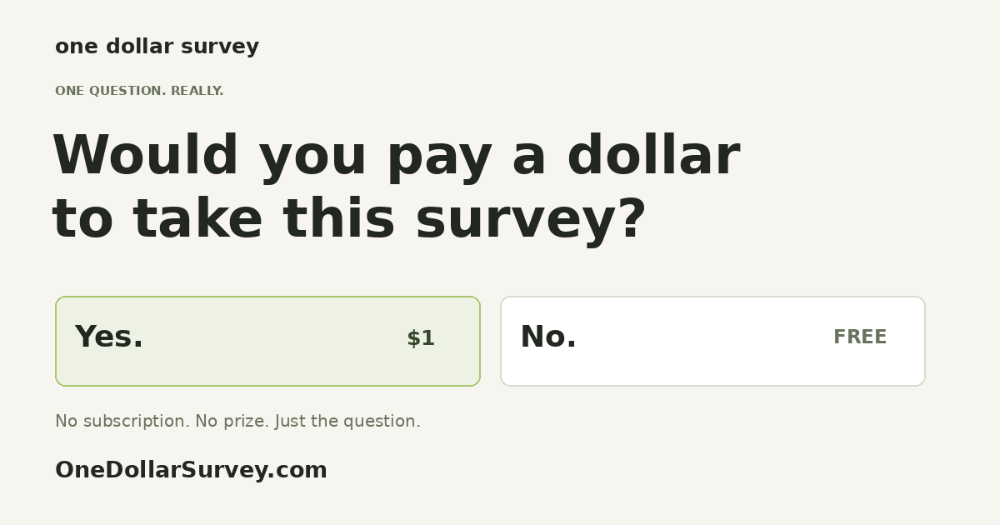

# One Dollar Survey

**[Take the survey →](https://onedollarsurvey.com/)** · [About & media](https://onedollarsurvey.com/about.html)

Would you pay a dollar to take this survey? No is free. Yes costs an actual $1 USD, once. That is the entire survey.

A standalone novelty internet experiment. Separate repository, Vercel project, database, and Stripe account from other projects.

## Current state
Live at https://onedollarsurvey.com/. The .app domain redirects to .com. The owner completed a real payment and the live results show confirmed Yes responses. No is free; live Yes payments are $1 USD, once. See [the launch outreach record](docs/launch-outreach.md) for discovery work and verified submission receipts.

## Deploy
Import this repository into a NEW Vercel project named `take-the-survey`, framework preset Other, output directory `public`, no build command. Use Node 24. Create a dedicated PostgreSQL database (e.g. Neon), execute `schema.sql`, and add environment variables from `.env.example` in Vercel. Never commit actual credentials. APP_ORIGIN must equal the deployed HTTPS origin, without trailing slash.

Use a random COOKIE_SECRET of at least 32 characters. Set a Stripe TEST secret key, register `/api/webhook` for `checkout.session.completed`, set its signing secret, then set PAYMENTS_ENABLED=true. Test a successful payment, decline, cancel, duplicate webhook delivery, cooldown and concurrent submissions. Keep production and preview databases, Stripe endpoints and origins separate. Test-mode payments are for testing only; reset test results or use a clean production database before launch.

For a new installation, publish a verified support/refund contact, review actual privacy practices, configure provider-level rate limits and payment branding, and complete sandbox testing before enabling live payments. The deployed One Dollar Survey installation has completed this launch setup.

## Data
`totals` holds aggregate counts. `browser_limits` holds hashes of random signed cookie IDs and cooldown timestamps; no IP address is stored. Delete expired rows periodically with `DELETE FROM browser_limits WHERE blocked_until < now()`. `payments` holds Stripe Checkout IDs plus browser hashes for atomic, exactly-once Yes counting. Browser hashes are cleared from counted payment rows during fulfillment. No names, email addresses or card details are copied from Stripe. Provider logs may contain operational information.

The cookie is Secure, HttpOnly, SameSite=Lax and lasts two hours. The server atomically reserves a browser for an hour on submission or checkout initiation. This intentionally simple anti-spam approach is bypassable by clearing cookies. Cancelled or failed checkout reserves the browser for the remainder of that hour; this avoids repeated payment attempts. A verified Stripe webhook counts paid $1 USD sessions associated with this project, not the redirect URL. Refunded/disputed payments currently remain historical Yes responses.

## Checks
`npm install`, `npm run check`, `npm test`. Payment/database integration needs actual test-service configuration; unit checks do not prove the complete payment flow.

## Payment mode
PAYMENT_MODE defaults to test. Only sk_test_ or rk_test_ credentials enable checkout in this mode, and the interface labels checkout and counts as test data. Real payments require a deliberate later PAYMENT_MODE=live configuration, a live key, a matching live webhook and clean production database.

## Launch preparation
- `survey-test` / `survey` contains sandbox data. `survey-live` / `survey_live` is a separate live database, now containing real responses. Set LIVE_DATABASE_URL to its limited `survey_live_app` role. Live mode never falls back to the test database.
- The public support/refund page offers full refund requests within 30 days. Contact email is displayed only after SUPPORT_EMAIL_VERIFIED=true and SUPPORT_EMAIL is set. Create and test the help@onedollarsurvey.com mailbox/forward first.
- Live checkout additionally requires LIVE_STRIPE_ACCOUNT_CONFIRMED=true, a live-mode secret key, and the live webhook signing secret. Use a dedicated Stripe account under the existing login for receipts, legal business information, support details and statement branding. A per-session display-name override alone does not separate receipts or statement prefixes.
- Never set PAYMENT_MODE=live during sandbox testing. Set PAYMENTS_ENABLED=false during any live credential/database transition. Verify the exact account, webhook, contact route, zero totals, then enable.
- App anti-spam: signed browser cookie, 15-minute browser-bound form proof with 750ms minimum age, hidden honeypot, origin/content-type checks and atomic one-hour cooldown. Vercel WAF additionally limits POST /api/survey to ten requests per minute per IP; the webhook endpoint is excluded.
- Branding is scoped to survey Checkout Sessions. No Sunday Serve account-wide branding settings are changed.

## Separate live Stripe credentials
Live mode uses STRIPE_LIVE_SECRET_KEY, LIVE_STRIPE_WEBHOOK_SECRET, LIVE_STRIPE_PRICE_ID and LIVE_STRIPE_ACCOUNT_ID. Test mode continues using STRIPE_SECRET_KEY and STRIPE_WEBHOOK_SECRET. Before live checkout is enabled, verify the dedicated live account and set LIVE_STRIPE_ACCOUNT_CONFIRMED=true; resolve the tax-handling choice, then set LIVE_TAX_READY=true. The deployed site uses manual tax handling with STRIPE_TAX_ENABLED=false and an exact $1 USD price. Checkout retrieves the account before starting a live session and refuses a mismatched account or disabled charges. The support contact is verified working by the owner.

## Launch tax choice and readiness
The owner chose to track taxes independently. STRIPE_TAX_ENABLED=false disables Stripe automatic tax calculations; this does not determine or remove any tax obligations. The $1 price remains fixed. LIVE_TAX_READY records that the launch tax-handling decision is resolved, not that a tax registration was created.
An authenticated GET /api/readiness uses SETUP_CHECK_TOKEN as a Bearer token and returns only live-account/price/webhook readiness flags. It never returns account details or credentials. It checks the key against the expected dedicated account, charges status, the $1 price and live webhook configuration. Missing authentication returns 404.

Checkout explicitly disables Managed Payments per session and uses allowed_payment_method_types to filter dynamic methods to cards. This preserves the direct-payment integration and independent tax handling even when the account has Managed Payments enabled by default. Session creation is pinned to the documented 2026-09-30.endive Stripe API.

## Search and sharing
The static homepage includes canonical, Open Graph and Twitter card metadata. `/robots.txt` advertises `/sitemap.xml`; API routes are excluded from crawling. `/about.html` provides the project story, honest limitations and reusable wide, square and story artwork. The share controls use native sharing when available and provide a clipboard link with a manual fallback. No analytics identifiers or visitor profiles were added.

Search-engine notification: the IndexNow verification file is intentionally public as required by the protocol. Re-submit only when public pages change, not for each vote. Google Search Console submission requires an authenticated owner session and is separate from IndexNow.

## Sharing kit generator
`public/sharing-kit.html` hosts a reusable twelve-second vertical video, direct-link QR assets, printable cards, and a script-free SVG badge. `scripts/generate-sharing-kit.py` reproduces the QR/card/video assets using development-only Pillow, qrcode, zxing-cpp and ffmpeg. None are application runtime dependencies. QR outputs are independently decoded during generation. The badge and print pages do not submit votes or expose payment details.
